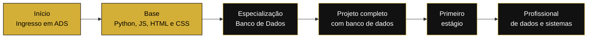

<div align="center">



</div>

<br/>

## Ficha do personagem

<div align="center">


</div>

---

## Sobre

Sou estudante de **Análise e Desenvolvimento de Sistemas**, no segundo semestre, com interesse especial em **banco de dados**: modelagem, consultas e a forma como os dados sustentam as aplicações.

Tenho mais familiaridade com **Python, JavaScript, HTML e CSS**, que uso para construir a lógica e a interface dos meus trabalhos. Mantenho o GitHub ativo e publico aqui os projetos e trabalhos acadêmicos que desenvolvo ao longo do curso.

- **Foco:** banco de dados
- **Formação:** Análise e Desenvolvimento de Sistemas (2º semestre)
- **Linguagens:** Python, JavaScript, HTML e CSS
- **Interesse:** transformar dados em sistemas confiáveis e bem organizados
- **Aberto a:** estágio, projetos colaborativos e troca de conhecimento

---

## Atributos

> Os níveis refletem o momento atual, de 0 a 10. Evoluem junto com o curso.

| Atributo | Nível | Progresso |
|:--|:--:|:--|
| **Banco de Dados** (foco) | 3/10 | `███░░░░░░░` |
| **Python** | 5/10 | `█████░░░░░` |
| **HTML** | 5/10 | `█████░░░░░` |
| **JavaScript** | 4/10 | `████░░░░░░` |
| **CSS** | 4/10 | `████░░░░░░` |

---

## Árvore de habilidades: Banco de Dados

Minha especialização. Cada habilidade desbloqueada abre a próxima.

| Habilidade | Estado |
|:--|:--:|
| Modelagem de dados (MER e DER) | Em andamento |
| SQL básico (SELECT, INSERT, UPDATE, DELETE) | Em andamento |
| Normalização | Bloqueada |
| SQL intermediário (JOIN e subconsultas) | Bloqueada |
| Índices e desempenho | Bloqueada |
| Views, procedures e triggers | Bloqueada |
| Integração do banco com Python ou JavaScript | Bloqueada |

---

## Conquistas

| Conquista | Estado |
|:--|:--:|
| Ingressou no curso de Análise e Desenvolvimento de Sistemas | Desbloqueada |
| Publicou trabalhos acadêmicos no GitHub | Desbloqueada |
| Escreveu programas em Python | Desbloqueada |
| Construiu páginas com HTML, CSS e JavaScript | Desbloqueada |
| Concluir um projeto completo com banco de dados | Bloqueada |
| Publicar um projeto online | Bloqueada |
| Conquistar o primeiro estágio | Bloqueada |

---

## Mapa da jornada



---

## Chefe final: o primeiro estágio

| Chefe | **Primeiro estágio em dados ou desenvolvimento** |
|:--|:--|
| Preparação | `███████░░░░░░░░░░░░░` **33%** |

**Itens necessários para a batalha:**

- [x] GitHub com perfil organizado e README profissional
- [x] Perfil criado no LinkedIn
- [ ] 3 projetos publicados e bem documentados
- [ ] 1 projeto completo com banco de dados
- [ ] Portfólio online (GitHub Pages)
- [ ] Candidatar-se às primeiras vagas

---

## Missões semanais

- [ ] Fazer commits em pelo menos **3 dias** da semana
- [ ] Praticar **consultas SQL** por 1 hora
- [ ] Documentar um projeto com um **README** claro
- [ ] Estudar o código de **um projeto** de outra pessoa

---

## Projetos em destaque

> Edite esta tabela com os projetos reais. Escolha os 3 melhores e explique o que cada um faz.

<div align="center">

| Projeto | Descrição | Tecnologias |
|:--|:--|:--|
| **[Nome do projeto 1](https://github.com/PettersonAguilar)** | Uma frase explicando o problema que ele resolve | `Python` |
| **[Nome do projeto 2](https://github.com/PettersonAguilar)** | Uma frase explicando o problema que ele resolve | `HTML` `CSS` `JavaScript` |
| **[Nome do projeto 3](https://github.com/PettersonAguilar)** | Uma frase explicando o problema que ele resolve | `Banco de Dados` |

</div>

---

## Estatísticas do jogador

Seção atualizada automaticamente pelo GitHub Actions, a partir da API oficial do GitHub.

<!--STATS_START-->
Aguardando a primeira atualização automática.
<!--STATS_END-->

---

## Fase secreta

<details>
<summary><b>Você encontrou uma fase secreta. Clique para abrir.</b></summary>

<br/>

```text
↑ ↑ ↓ ↓ ← → ← → B A     CÓDIGO KONAMI ATIVADO
```

Bônus desbloqueado: quem chega até aqui merece uma conversa. Me chame no LinkedIn ou por e-mail para trocarmos ideias sobre banco de dados, projetos e oportunidades.

</details>

---

## Contato

<div align="center">

[**LinkedIn**](https://www.linkedin.com/in/pettersonaguilar) &nbsp;·&nbsp; [**E-mail**](mailto:pettersonmichellima@gmail.com) &nbsp;·&nbsp; [**GitHub**](https://github.com/PettersonAguilar)

<br/>


</div>
