 

## Ficha do personagem

---

## Sobre

Estudante do 2º semestre de **Análise e Desenvolvimento de Sistemas**, com foco em **Engenharia de Dados** e interesse em desenvolvimento web. Uso **Python** e **JavaScript** na lógica e construo interfaces com **HTML** e **CSS**.

No GitHub, publico os projetos acadêmicos que desenvolvo em equipe, trabalhando com fork e pull request, e documento o que construo.

- **Formação:** Análise e Desenvolvimento de Sistemas (2º semestre)
- **Trabalho em equipe:** projetos com 5 e 9 integrantes
- **Aberto a:** estágio e projetos colaborativos

---

## Stack

| Área | Tecnologias |
|:--|:--|
| Linguagens | Python, JavaScript |
| Web | HTML5, CSS3 |
| Dados (em estudo) | Banco de dados relacionais e SQL |
| Colaboração | Git, GitHub (fork, pull request e documentação) |

---

## Projetos

| Projeto | O que é | Minha parte | Tecnologias |
|:--|:--|:--|:--|
| **[TopFive Cinema](https://github.com/PettersonAguilar/TopFiveCinema)** | Site em equipe (9 integrantes) da disciplina Desenvolvimento Front-End para Web, com os 5 filmes mais bem avaliados de 7 gêneros e 39 páginas HTML | Páginas e CSS dos 5 filmes de Comédia | `HTML5` `CSS3` `JavaScript` |
| **[Dossiê 4: Deepfakes e Proveniência de Conteúdo](https://github.com/PettersonAguilar/-Deepfakes-e-Proveniencia-Digital-Autenticidade-Rastreabilidade-e-Confiabilidade-do-Conte-do-)** | Proposta técnica em equipe (5 integrantes) do VerificaBR, plataforma de verificação assistida de áudios e vídeos, com arquitetura, ética, LGPD e acessibilidade | Integrante da área de Engenharia de Dados | `Arquitetura` `C2PA` `LGPD` `WCAG` |
| **[Perfil automatizado](https://github.com/PettersonAguilar/PettersonAguilar)** | Este README: as estatísticas abaixo são atualizadas sozinhas por um workflow que consulta a API do GitHub | Configuração do repositório e do workflow | `Python` `GitHub Actions` |

---

## Próximas fases

| Fase | Objetivo | Estado |
|:--|:--|:--:|
| 1 | Projetos em equipe com Git e pull requests | Concluída |
| 2 | Projeto individual com demonstração online (GitHub Pages) | Próxima |
| 3 | Projeto de dados com Python: coleta, tratamento e consulta | Bloqueada |
| 4 | Primeiro estágio | Bloqueada |

---

## Estatísticas do jogador

Atualizadas automaticamente pelo GitHub Actions, a partir da API oficial do GitHub.

<!--STATS_START-->

### Nível 5 · Aprendiz

`███░░░░░░░░░░░░░░░░░` **15%** para o nível 6 · **870 XP**

| Estatística | Valor |
|:--|--:|
| Repositórios públicos | **4** |
| Commits no último ano | **32** |
| Sequência atual | **2 dias** |
| Maior sequência (último ano) | **2 dias** |
| Pull requests | **5** |
| Issues abertas | **0** |
| Estrelas recebidas | **0** |
| Seguidores | **20** |
| No GitHub desde | **2026** |

**Atividade nas últimas 26 semanas:** `▁▁▁▁▁▁▁▁▁▁▁▁▁▁▁▁▁▁▃▁▁▁▂▁▁█`

#### Conquistas do GitHub

| Conquista | Status |
|:--|:--:|
| Criou o primeiro repositório | Desbloqueada |
| 5 repositórios públicos | Bloqueada |
| 10 commits no último ano | Desbloqueada |
| 100 commits no último ano | Bloqueada |
| 7 dias seguidos de commits | Bloqueada |
| Abriu um pull request | Desbloqueada |
| Ganhou a primeira estrela | Bloqueada |
| 10 seguidores | Desbloqueada |

Atualizado automaticamente em 10/11/2026 21:59 (Brasília)
<!--STATS_END-->

---

## Contato

[**LinkedIn**](https://www.linkedin.com/in/pettersonaguilar) &nbsp;·&nbsp; [**E-mail**](mailto:pettersonmichellima@gmail.com) &nbsp;·&nbsp; [**GitHub**](https://github.com/PettersonAguilar)

 

